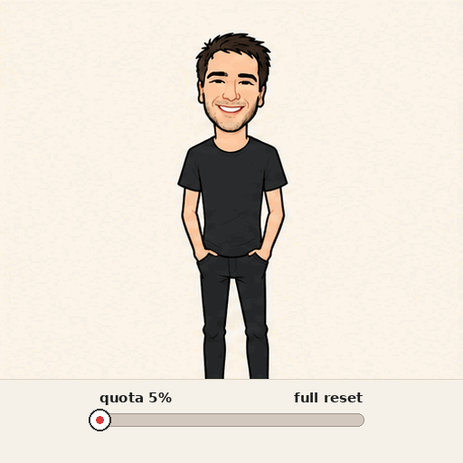

<div align="center">

<h1>openai-image</h1>

<p>Generate and edit images with OpenAI from any MCP client.</p>

<p>
  <a href="https://www.npmjs.com/package/@felixpy/openai-image"></a>
  <a href="LICENSE"></a>
  <a href="https://github.com/felixpy/openai-image/actions/workflows/ci.yml"></a>
  <a href="package.json"></a>
</p>


<p><sub>Animated GIF output from <code>openai_image_edit</code> (<code>output_format: "gif"</code>).</sub></p>

<p>
  <a href="README.md">English</a>
  &nbsp;·&nbsp;
  <a href="README_ZH.md">简体中文</a>
</p>

</div>

`openai-image` is a stdio [Model Context Protocol](https://modelcontextprotocol.io) server. It calls the official OpenAI Images API, writes the files to an absolute `output_dir`, and returns paths plus metadata. Tool results never include base64.

```sh
npx -y @felixpy/openai-image@latest
```

## Quick start

### 1. API key

The server reads `OPENAI_API_KEY` from the environment. It is required for a tool call and is never logged. A missing key does not stop the process from starting.

```sh
export OPENAI_API_KEY=sk-...
```

| Variable | Default | Role |
|---|---|---|
| `OPENAI_API_KEY` | required for tool calls | Sent by the OpenAI SDK. Never commit it. |
| `OPENAI_IMAGE_MODEL` | `gpt-image-2.6-flare` | Model used when a call omits `model`. |
| `OPENAI_BASE_URL` | OpenAI default | Optional. Read by the OpenAI SDK. |

### 2. Register the server

Every snippet starts the published package over stdio. Replace `sk-...` locally. Do not commit a real key.

Bare `npx -y <pkg>` can keep reusing a cached older version, while `@latest` makes npx check npm on each start; pin a version like `@0.2.0` instead if you want reproducible behavior.

#### Cursor

`~/.cursor/mcp.json` or `.cursor/mcp.json`:

```json
{
  "mcpServers": {
    "openai-image": {
      "command": "npx",
      "args": ["-y", "@felixpy/openai-image@latest"],
      "env": {
        "OPENAI_API_KEY": "sk-..."
      }
    }
  }
}
```

#### Claude Desktop

macOS: `~/Library/Application Support/Claude/claude_desktop_config.json`  
Windows: `%APPDATA%\Claude\claude_desktop_config.json`  
Linux: `~/.config/Claude/claude_desktop_config.json`

```json
{
  "mcpServers": {
    "openai-image": {
      "command": "npx",
      "args": ["-y", "@felixpy/openai-image@latest"],
      "env": {
        "OPENAI_API_KEY": "sk-..."
      }
    }
  }
}
```

#### Claude Code

```sh
claude mcp add openai-image \
  -e OPENAI_API_KEY=sk-... \
  -- npx -y @felixpy/openai-image@latest
```

#### Codex

`~/.codex/config.toml`:

```toml
[mcp_servers.openai-image]
command = "npx"
args = ["-y", "@felixpy/openai-image@latest"]
env = { OPENAI_API_KEY = "sk-..." }
```

## Tools

| Tool | API | Required | Also accepts |
|---|---|---|---|
| `openai_image_generate` | `images.generate` | `prompt`, `output_dir` | Shared image fields, plus `svg` |
| `openai_image_edit` | `images.edit` | `prompt`, `image_paths`, `output_dir` | Shared image fields, plus `mask_path`, `markup_path`, `input_fidelity` |

`openai_image_generate` creates still images, animated GIFs (`output_format=gif`), or SVG. `openai_image_edit` edits or composes up to 16 reference images, optionally guided by a mask or a markup overlay. Both save files under `output_dir` and return their paths.

A successful result is text JSON. URLs and `revised_prompt` are included only when the API sends them.

```json
{
  "model": "gpt-image-2.6-flare",
  "files": ["/absolute/path/image-2026-11-05T00-00-00-000Z-0.png"],
  "usage": null,
  "size": "1024x1024",
  "quality": "auto",
  "output_format": "png"
}
```

API failures, including `moderation_blocked`, come back as tool errors with `status`, `code`, `type`, `param`, `message`, `request_id`, and the raw `error` body. The client uses `maxRetries: 2` and a 180 second timeout.

## Parameters

Schemas are loose strings on purpose. The API validates values, so a new option usually needs no code change. Unknown fields can go through `extra`, which is shallow-merged last.

### Shared

| Parameter | Required | Range and notes |
|---|---|---|
| `output_dir` | yes | Absolute directory. A relative path is rejected. The directory is created if needed. |
| `model` | no | Default is `OPENAI_IMAGE_MODEL` or `gpt-image-2.6-flare`. Examples: `gpt-image-2.6-flare` (fast), `gpt-image-2.6-sunburst` (detail and precise edits), `gpt-image-2.5-flare`, `gpt-image-2.5-sunburst`. |
| `size` | no | `auto`, `1024x1024`, `1536x1024`, `1024x1536`, or `WIDTHxHEIGHT`. Both sides must be multiples of 16, the aspect ratio must be from 1:3 to 3:1, and the maximum is `3840x2160`. For GIF this is the size of each frame. Keep frames small, for example `512x512`, so the animation fits the pixel budget. |
| `quality` | no | `auto` (default), `low`, `medium`, `high`, `xhigh`, `max`. |
| `complexity` | no | Planning effort, separate from quality: `low`, `medium`, `high`. gpt-image-2.6 defaults to `high`. |
| `n` | no | Integer from 1 to 10. |
| `background` | no | `auto` (default), `opaque`, `transparent`. Transparent requires `png`, `webp`, or `svg`. |
| `output_format` | no | `png` (default), `jpeg`, `webp`. Generate also supports `gif` (animated) and `svg`. |
| `output_compression` | no | Integer from 0 to 100. `jpeg` and `webp` only. |
| `frame_count` | no | GIF only. Integer, minimum 2, default 9. The SDK documents 2–16 and the image guide documents 2–64. Describe the motion and a return to the starting pose so the loop is smooth. |
| `frame_duration_ms` | no | GIF only. Integer from 20 to 2000, rounded to 10. Default 200. |
| `moderation` | no | `auto` (default), `low`. |
| `safety_identifier` | no | Optional stable hashed end-user id for OpenAI abuse monitoring. |
| `extra` | no | Object shallow-merged into the request last, for example `{"complexity":"high"}`. |

### `openai_image_generate`

| Parameter | Required | Range and notes |
|---|---|---|
| `prompt` | yes | Text prompt. Maximum 32000 characters. |
| `svg` | no | SVG only, with `output_format=svg` and `n=1`. Object `{"model":"...","reasoning":{"effort":"high"}}`. Needs SVG model-selection access. Omit it otherwise. |

### `openai_image_edit`

| Parameter | Required | Range and notes |
|---|---|---|
| `prompt` | yes | Edit instructions. |
| `image_paths` | yes | Local paths. Minimum 1. The API accepts up to 16 reference images. |
| `mask_path` | no | PNG mask, same size as the first image. Transparent pixels are the area to edit. Cannot be combined with `markup_path`. |
| `markup_path` | no | Transparent PNG overlay with marks, arrows, or notes, same size as the first image. Cannot be combined with `mask_path`. |
| `input_fidelity` | no | `high` or `low`. Applies to `gpt-image-1.5` and `1-mini` only. Omit it for gpt-image-2 and later. |

Edit accepts the shared fields, including `output_format`. GIF output from edit was verified on 2026-11-05.

## Notes

- **GIF.** Set `output_format` to `gif` on generate or edit. Use `frame_count` and `frame_duration_ms` to shape the loop. Edit GIF output was verified on 2026-11-05.
- **Absolute `output_dir`.** The path must be absolute. Relative paths are rejected before the API is called.
- **No base64 in tool results.** Bytes are written to disk. The tool returns file paths, the model, `usage`, and `revised_prompt` when the API provides one.
- **Pass-through.** `extra` is shallow-merged last, so new API fields work without a release.

## Development

Node.js 20 or newer.

```sh
npm ci
npm test
npm run build
npm start
```

`npm test` builds `dist/` and completes an MCP `initialize` plus `tools/list` handshake. It does not call the OpenAI API and does not need `OPENAI_API_KEY`.

See [CONTRIBUTING.md](CONTRIBUTING.md) for commit style and pull requests, and [docs/publishing.md](docs/publishing.md) for the one-time npm setup.

## Project

- [Contributing](CONTRIBUTING.md)
- [Security](SECURITY.md)
- [License](LICENSE) (MIT)
- [Changelog](CHANGELOG.md)
- [Code of Conduct](CODE_OF_CONDUCT.md)
- [Publishing](docs/publishing.md)
